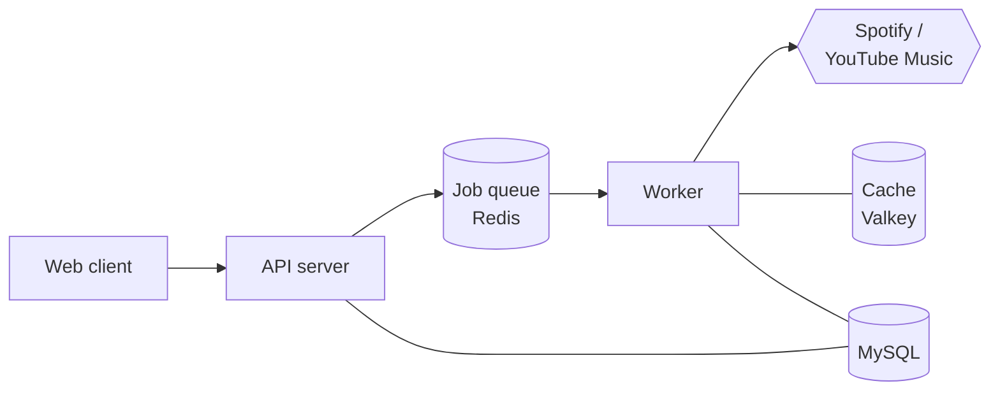
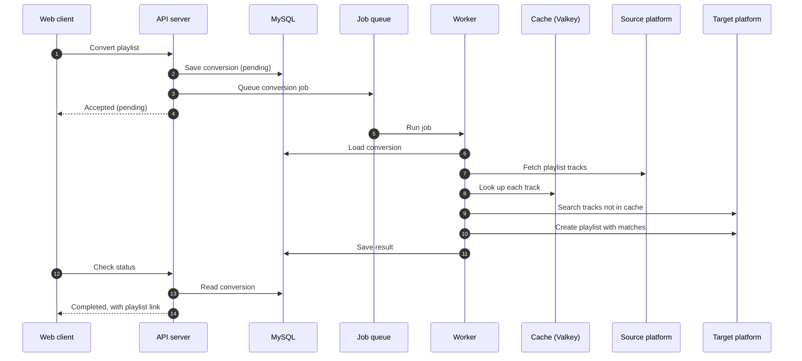

# Playlift

Playlift converts playlists between Spotify and YouTube Music. Live at [playlift.lol](https://playlift.lol).

- **Account conversions**: sign in with Google, connect Spotify and/or YouTube Music, and convert playlists from your own library.
- **Background conversions**: conversions run as queued jobs; the details page shows their status and results.
- **Playlist watching**: a converted playlist can be kept in sync; a cron job picks up changes to the source and re-syncs the target.

## Architecture



1. The web client asks the API server to convert a playlist.
2. The API server saves the conversion in MySQL and puts a job on the queue.
3. The worker picks up the job, reads the source playlist, finds each track on the other platform (checking the Valkey cache first) and creates the new playlist.
4. The worker saves the result in MySQL, and the web client reads it back through the API server.

A cron inside the API server also queues sync jobs for watched playlists every 10 minutes.

### Conversion flow

How a playlist gets converted, at a high level:



- A track that isn't found is stored as `Not found`; a platform error is stored as `server error`. Neither stops the rest of the conversion.
- If anything outside the per-track search fails (missing tokens, playlist fetch, playlist creation), the conversion is saved as `failed`. The job itself still returns success, so Asynq doesn't retry it.
- **Watch sync** (`watch:sync`) runs the same search on a smaller set: it fetches the source tracks, finds tracks that weren't there at the last sync, searches for those one at a time, appends matches to the existing target playlist, and updates the watch's `last_synced_at`.

| Part       | Location                                                       | What it does                                                    |
| ---------- | -------------------------------------------------------------- | --------------------------------------------------------------- |
| API server | [main.go](main.go), [server/](server/), [handlers/](handlers/) | Echo HTTP API on `PORT` (8080 in dev), sessions                 |
| Worker     | [worker/](worker/), [tasks/](tasks/)                           | Asynq worker that runs `playlist:convert` and `watch:sync` jobs |
| Converter  | [core/](core/)                                                 | Spotify and YouTube Music clients and the track-matching logic  |
| Cron       | [cron-jobs/](cron-jobs/)                                       | Schedules sync jobs for watched playlists                       |
| Web client | [web/](web/)                                                   | React + Vite + Chakra UI frontend on port 3500                  |

Backing services:

- **MySQL** for users, tokens, conversions and watches (GORM auto-migrates on server start).
- **Redis** for the Asynq job queue.
- **Valkey** for caching track matches and conversion state.

## Prerequisites

- Go 1.25+
- Node.js and npm
- MySQL, Redis and Valkey running locally (or reachable)
- A Spotify app and a Google OAuth client

## Setup

1. Install dependencies (Go modules, web packages and [air](https://github.com/air-verse/air)):

   ```sh
   make install-deps
   ```

2. Create the backend env file and fill it in:

   ```sh
   cp .env.example .env
   ```

   Required: `DB_USER`, `DB_NAME`, `DB_HOST`, `DB_PORT`, `SPOTIFY_CLIENT_ID`, `SPOTIFY_CLIENT_SECRET`, `GOOGLE_CLIENT_ID`, `GOOGLE_CLIENT_SECRET`, `SESSION_KEY`, `VALKEY_URL`, `REDIS_HOST`, `REDIS_PORT`.
   Also set `PORT` (e.g. `8080`) and `FRONTEND_BASE_URL` (e.g. `http://localhost:3500`).
   In production (`GO_ENV=production`), `VALKEY_USERNAME` and `VALKEY_PASSWORD` are required too.

3. Create the frontend env file and fill it in:

   ```sh
   cp web/.env.example web/.env
   ```

   `VITE_API_BASE_URL`, `VITE_GOOGLE_CLIENT_ID`, `VITE_SPOTIFY_CLIENT_ID`, `VITE_SPOTIFY_REDIRECT_URI`.

4. Run migrations if needed (the server also auto-migrates on start):

   ```sh
   make migrate            # or: make migrate cmd=down|status|redo
   ```

## Running

Start the server, worker and client together:

```sh
make dev
```

Or run them separately:

```sh
make server   # Go API with hot reload (air), :8080
make worker   # background job worker
make client   # Vite dev server, :3500
```

`make stop` kills all three; `make help` lists every target.

## Tests

```sh
go test ./...
```

Handler tests live in [handlers/](handlers/) and [tests/handlers/](tests/handlers/).
